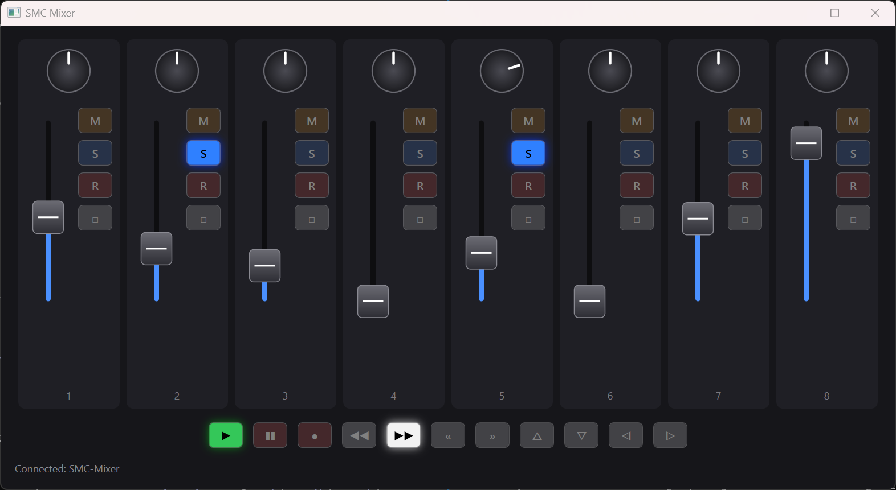

# M-VAVE SMC-Mixer

A C# library and apps for the M-VAVE SMC-Mixer MIDI controller. It reads the faders, knobs and buttons, and lights
the button LEDs from your code. The library runs on Windows and Linux; the desktop mirror app is Windows only.



The window above is a live mirror of the device: faders and knobs follow the hardware, and the LEDs light up in the
same colors as on the mixer.

## Requirements

- [.NET 10 SDK](https://dotnet.microsoft.com/download)
- **Windows 10 or 11**, or **Linux** with ALSA (`libasound2`; it is installed on most desktops). On Linux your user needs access to
  `/dev/snd/seq`, which on most distros means being in the `audio` group.
- The mixer connected by USB or Bluetooth and in **DAW mode**. To switch to it, hold SHIFT and press the `«` button.
  LEDs only respond in this mode.
- Bluetooth on Linux: pair and connect with `bluetoothctl` (BlueZ 5.50 or newer). The mixer then appears as an ALSA
  MIDI client. Bluetooth offers a single port, so LED feedback may not work there; use USB for LEDs.

## Projects

| Project | What it is |
|---|---|
| `SmcMixer.Core` | The library: the `Mixer` class with events for faders, knobs and buttons, and LED control. It has no OS dependencies: it talks to an `IMidiBackend`. |
| `SmcMixer.Windows` | `IMidiBackend` for Windows (winmm, through NAudio). |
| `SmcMixer.Linux` | `IMidiBackend` for Linux (ALSA sequencer, through [managed-midi](https://github.com/atsushieno/managed-midi)). |
| `SmcMixer` | Console app: prints every control change, and an `led` command for probing the LED protocol. Picks the backend for the current OS. |
| `SmcMixer.HomeAssistant` | Linux worker that maps the mixer's controls to Home Assistant lights (see below). |
| `SmcMixer.App` | WPF desktop app that mirrors the mixer (Windows only). Pressing a button toggles its LED. |
| `SmcMixer.Core.Tests` | Unit tests for the MIDI decoding. |

## Run

```
dotnet run --project SmcMixer.App     # desktop mirror (Windows)
dotnet run --project SmcMixer         # console monitor, buttons toggle their LEDs (Windows or Linux)
```

On Windows only one program can use the mixer's MIDI ports at a time, so close one before starting the other.

Console LED probe, for exploring the protocol (see the [MIDI notes](docs/midi-notes.md)):

```
dotnet run --project SmcMixer -- led <note> <velocity|sweep|scan|repl> [channel] [outputIndex]
```

## Using the library

```csharp
using SmcMixer.Core;

IMidiBackend backend = OperatingSystem.IsWindows()
    ? new SmcMixer.Windows.WindowsMidiBackend()
    : new SmcMixer.Linux.LinuxMidiBackend();

using var mixer = new Mixer(backend);             // auto-detects the MIDI ports
mixer.ControlChanged += (_, c) =>
{
    // c.Control.Name: "Fader 3", "Knob 1", "Mute 2", "Play", ...
    // c.Value: faders 0..1, knobs +/- ticks (relative), buttons 1 pressed / 0 released
    Console.WriteLine($"{c.Control.Name} {c.Value}");
};
mixer.Start();

mixer.SetLed(mixer.Buttons[16], true);            // note 16 = "Mute 1"
mixer.SetAllMuteLeds(false);
```

Events are raised on the MIDI driver's thread, so marshal to the UI thread before touching UI.

## Controls and LEDs

- 8 faders (pitch bend), 8 endless knobs (relative ticks), 32 strip buttons and 11 transport buttons.
- Strip buttons have fixed-color LEDs: **M** orange, **S** blue, **R** red and the square button white.
- Of the transport buttons, Play is green, Pause and Record are red, and Rewind and Forward are white.
  `«`, `»` and the four arrows light only while held, and can't be controlled over MIDI.
- LEDs are single-color and stay on until switched off.

## Limitations

- DAW mode only. The mixer's other mode (CC mode) has overlapping CC numbers and no working LED output.
- The app does not notice the mixer being unplugged while it runs.
- The square button is named `Select` in the code, which is a guess.

## Home Assistant (Linux)

`SmcMixer.HomeAssistant` is a worker that turns the mixer into a physical control panel for Home Assistant lights: faders set
brightness, knobs step color temperature and buttons toggle. Which control drives which light is set in
`SmcMixer.HomeAssistant/appsettings.json`. It reconnects by itself when the mixer disconnects and comes back.

Quick start, once the mixer is connected and in DAW mode:

```
# 1. Save a Home Assistant long-lived access token in ~/.config/smc-ha/token (mode 600)
# 2. Put your light entity ids in SmcMixer.HomeAssistant/appsettings.json
dotnet run --project SmcMixer.HomeAssistant        # try it
```

To run it permanently as a systemd user service, publish it and enable the unit:

```
dotnet publish SmcMixer.HomeAssistant -c Release -o ~/smc-ha
mkdir -p ~/.config/systemd/user && cp SmcMixer.HomeAssistant/smc-ha.service ~/.config/systemd/user/
sudo loginctl enable-linger $USER && systemctl --user daemon-reload && systemctl --user enable --now smc-ha.service
```

See **[docs/home-assistant.md](docs/home-assistant.md)** for the full guide: pairing the mixer over Bluetooth, creating the
token, every configuration option and control name, deploying and updating the service, and troubleshooting.

## More

- [docs/home-assistant.md](docs/home-assistant.md): connecting the mixer to Home Assistant on Linux, step by step.
- [docs/midi-notes.md](docs/midi-notes.md): everything known about the mixer's MIDI behavior in both modes, what is
  confirmed on the device, and what comes from third-party sources.
